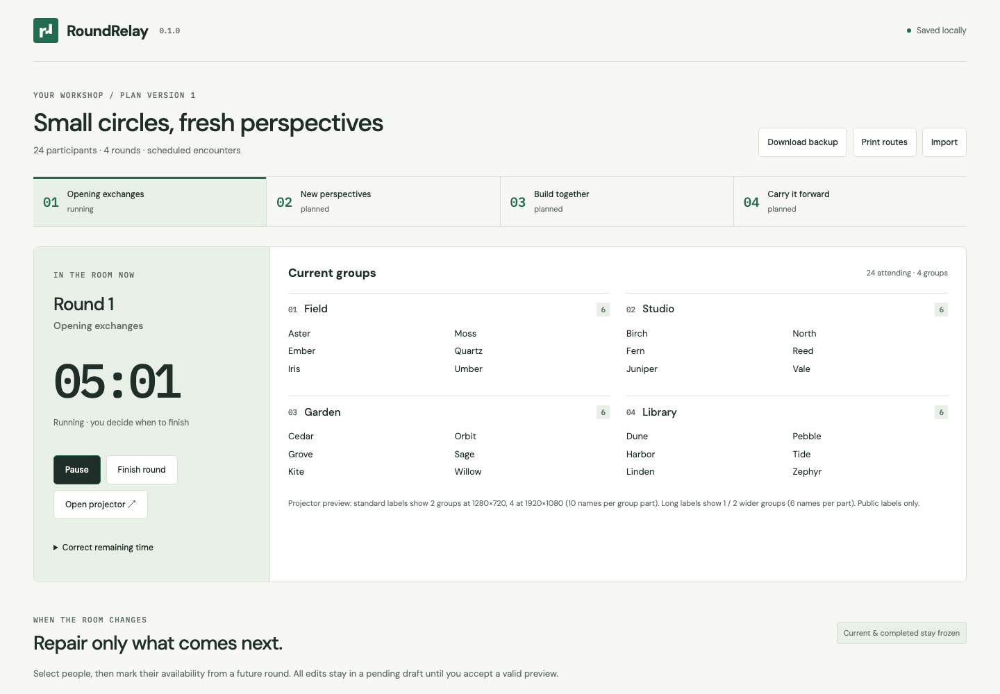

# RoundRelay

Run workshop rounds and repair future groups when attendance changes.

A finished local conductor for 20–60 participants and 3–6 rounds. Import an existing plan,
run the room, and preview a small future repair when someone leaves or arrives. Current
and completed rounds stay frozen. No account, paid API or application server.

**[Try sample](https://mikonyaa.github.io/roundrelay/)** ·
**[Releases](https://github.com/mikonyaa/roundrelay/releases)** · **[Demo](docs/DEMO.md)**

[Sample JSON](examples/workshop-24.json) · [CSV templates](examples) ·
[Public release QA](docs/POST-RELEASE-QA.md).

This checkout contains **0.1.1-rc.1**, a local lifecycle candidate. The public links above
refer to the existing release. See [candidate acceptance](docs/LOCAL-CANDIDATE-QA.md),
[compatibility](docs/MIGRATION-0.1.1.md) and the [room rehearsal](docs/ROOM-REHEARSAL.md).



## First result in 60 seconds

Open the app and choose **Try 24-person sample**. Start round 1, open the projector, and
finish the round explicitly. Select Aster and Birch, choose round 2, and mark them absent.
**Preview repair** shows six removed round assignments and **zero continuing-attendee
moves**. Apply the repair, then undo it before a changed round starts. Print routes or
download a portable event backup at any point. This is a synthetic rehearsal, not a real event.

For the release ZIP: extract everything, install Node.js **24.21.0 LTS**, then run:

```sh
node serve.mjs --port 0
```

Open the printed loopback URL. The included server serves only `app/`, requires no
node_modules, chooses an unused port and works without network access. Module assets
require HTTP; this is not a file:// app. See [offline instructions](docs/README-OFFLINE.md).

## Import your existing plan

Portable **EventProject v1 JSON** includes stable participant/group/round IDs, assignments
as arrays, explicit availability, conductor state, frozen snapshots and bounded repair history.
It also preserves an unresolved pending draft across reload or transfer. Import is previewed
and applied as one snapshot; replacing an open event requires an explicit reviewed action.
Download its backup first. Structurally valid plans with hard violations can be opened as
drafts; Start, CSV/print routes and public assignments are blocked until the accepted plan
passes independent validation. JSON backup and future repair remain available. A pending
edit to a valid plan does not change its accepted export routes. Unsupported versions and malformed input do not replace
the open event. [Format and limits](docs/FORMAT.md).

Alternatively, upload both CSVs:

```csv
participant_id,public_label
p01,"Aster, north"
p02,"Aster, north"
```

```csv
round,group,participant_id
1,field,p01
1,studio,p02
2,studio,p01
2,field,p02
```

Set group min/max and round seconds in the preview. A missing participant/round CSV row
means **absent**; unknown participant IDs and malformed rows are reported, never discarded.
Duplicate names remain separate people. Quoted commas, Unicode, BOM and CRLF are supported.
The [filled example](examples/participants.csv) pairs with [assignments.csv](examples/assignments.csv).
There is no unimplemented promise of arbitrary GroupMixer export compatibility.

## Run, repair and undo

One round can be running or paused. Start freezes its assignments, public labels, group bounds
and hard constraints. Finishing records the same frozen plan as historical scheduled encounters.
Timer expiry displays **Time is up**; it never finishes or advances a round for you.

Future attendance and min/max/enabled edits form one **pending draft**. The accepted plan
stays unchanged until Apply. Starting a future round is blocked until the draft is applied or
explicitly cancelled. Cancel discards the entire draft. A worker computes a proposal against
one exact revision; new attendance, timer controls or round state invalidate old results.
Apply independently validates the full candidate and the current/completed fingerprint.

The bounded planner uses this lexicographic objective:

1. Number of moves among continuing attendees relative to the accepted future plan.
2. Sum of `max(0, encounterCount − 1)` over unordered pairs, including frozen and future rounds.
3. Sum of squared group-size deviations from each round's mean enabled-group size.
4. Deterministic assignment ordering by participant and group IDs.

Attendance additions/removals are displayed separately and are not counted as moves. The
planner first tries keeping all continuing attendees in place. It then uses round-local bounded
search and optional valid swaps. **No global optimality or mathematically minimal-diff promise.**
Group IDs are never renamed to make the diff smaller. Encounters are scheduled, not proof
that every assigned person actually met. [Planner details and status corpus](docs/PLANNER.md).

| Result            | Meaning                                                                                 |
| ----------------- | --------------------------------------------------------------------------------------- |
| Feasible          | Independently validated candidate; frozen state preserved. Optimization may stop early. |
| Proven-infeasible | A numeric capacity contradiction, shown with attendance/min/max totals.                 |
| Unsolved          | Bounded search found no valid candidate; no impossibility claim.                        |
| Error             | Invalid input or failed independent validation; accepted plan is unchanged.             |

Hard availability, uniqueness, existing IDs, capacity and explicit `mustSeparate` pairs are
never weakened automatically. Edit only future group constraints explicitly, preview again,
or cancel. Default budget is 30,000 iterations / 1.8 seconds; worker cancellation terminates
the worker. Fixed inputs, seed, version and iteration budget reproduce the candidate when
the wall timeout does not stop the search sooner.

Undo restores the complete previous future availability, bounds/enabled and assignments
atomically. It is available only for the last accepted repair, at its unchanged revision, while
all affected rounds remain planned. Starting an affected round permanently closes that undo
boundary. Timer changes also change the revision. The journal stores at most 100 repairs and
prunes older entries sooner to keep a pretty-printed backup within the 2 MiB import limit.

## Projector, printing and time

**Open projector** creates a separate same-origin tab in the **same browser environment**.
BroadcastChannel transmits a strict, versioned public snapshot and heartbeat: title, round,
group labels, public aliases, timer and revision. It never transmits private notes, constraint
reasons, history or the complete project. The projector does not read IndexedDB or accept
commands. It requests a fresh snapshot on connection/reload and marks disconnected data
stale after conductor heartbeats stop. Popup blocking is explained with a retry action.
The v2 envelope orders snapshots by a tab session, workspace epoch and sequence, independently
of the event's revision. An existing projector follows replacement events and older restored
backups. Rejected packets do not refresh Live. See the [projection protocol](docs/PROJECTION-PROTOCOL.md).

Projector pagination keeps labels readable: standard labels use two groups per page at
1280×720 and four at 1920×1080, with ten-name parts for larger groups. Long labels use wider
groups and six-name parts. Page controls and fullscreen/exit are explicit. No flashing.
This is **not phone synchronization** or cryptographic isolation from other same-origin scripts.

**Print routes** opens a public-only preview with plan version, individual routes and a group
plan. Completed rounds are marked historical. Print CSS repeats table headers, wraps names,
and keeps route blocks together. [24-person printable example](examples/printable-routes-24.pdf).
Exported CSV escapes formula-leading fields for spreadsheets.

Running remaining time is `max(0, deadlineEpochMs − Date.now())`. Rendering does not count
down a stored counter. Pause saves remaining time; resume creates a new wall deadline.
Reload, backgrounding and controlled renderer suspension are tested with real elapsed time.
Visible wall/monotonic disagreement is flagged; remaining time can be corrected manually.
System-clock changes during sleep cannot reliably be distinguished from elapsed time using
two local clocks. **Hardware sleep of a Mac was not tested.** [Validation evidence](docs/QA.md).
That evidence describes the previous release. Candidate gates and actual BFCache requirements
are listed in [local candidate acceptance](docs/LOCAL-CANDIDATE-QA.md).

## Local storage and privacy

IndexedDB transactions commit snapshots, revisions, pending drafts and history together.
**Saved locally** appears only after commit. Storage errors preserve the in-memory snapshot
and expose Download backup. Browser storage is not a guaranteed backup. A second conductor
is read-only; transactional owner leases and generation checks prevent competing writers.
After the old owner closes, **Recover saved event** loads the last committed state explicitly.
No automatic merging. A suspended owner that loses its lease is fenced from further saves.
Page return reopens storage and reacquires ownership. Queued edits survive if the saved
snapshot has not changed; competing writes leave the returning draft available for backup
before explicit recovery. Connection and persisted lease epochs fence retired operations.
See [recovery and durability](docs/RECOVERY.md).

Participant data is never uploaded. There are no analytics, remote fonts, account endpoints,
remote project assets or service worker. All fixtures and demo aliases are original synthetic
data. Optional private notes remain private to conductor storage/portable JSON; use public
aliases if names should not be projected. HTML labels render as text, never executable markup.

## Development and supported browsers

Node 24.21.0 is pinned in `.nvmrc`; the lockfile is committed. Dependencies are exact versions.

```sh
npm ci
npx playwright install chromium firefox webkit  # once; Linux CI adds --with-deps
npm run dev -- --host 127.0.0.1
npm run typecheck
npm run lint
npm run test:unit
npm run build
npm run test:e2e
ROUNDRELAY_ALL_BROWSERS=1 npm run test:e2e
npm run package:web
npm run test:production
npm run test:suspension
# With the dev server running in another terminal:
ROUNDRELAY_URL=http://127.0.0.1:5173/ npm run demo:record
```

Tests use separate temporary browser profiles. Chromium is the primary tested browser;
Firefox and Playwright WebKit are tested explicitly. WebKit is not a claim of testing Safari.
The independent tiny-case oracle enumerates assignments, not calls back into the planner.
CI tests multi-tab privacy/ownership, packages the built app, extracts the final ZIP outside
the source tree, and rehearses it with the supplied dependency-free server.

## License and scope

RoundRelay code, its original planner and synthetic examples are **MIT**. React, ReactDOM,
Zod and PapaParse are MIT; locally bundled DM Sans and IBM Plex Mono are OFL-1.1.
Full [runtime notices](docs/THIRD-PARTY-NOTICES.txt) and [locked dependency inventory](docs/dependencies.json)
are included. No competitor code was copied. [Bounded competitor/reuse review](docs/BASELINE.md).

No accounts, RSVP, tickets, payments, affinity language, global optimizer, cloud event platform
or native app. Feedback sessions with real facilitators are a follow-up experiment; none are
invented and they are not a technical release gate.
